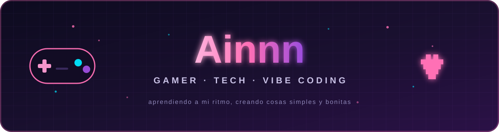

  

## 👾 Hola, soy Ainnn

Gamer y curiosa de la tecnología. Me gusta **armar cositas para mi PC**, personalizar mi setup, probar apps y aprender programando a mi ritmo. Nada de proyectos gigantes: cosas simples, útiles y con un poco de magia.

- 🎮 **Jugando:** Valorant, Minecraft y algún indie que me atrape.
- 🛠️ **Cacharreando:** scripts para Windows, pequeñas apps y automatizaciones.
- 🌱 **Aprendiendo:** C#, PowerShell y todo lo que me sirva para el próximo proyecto.
- 💜 **Filosofía:** *si funciona y se ve bonito, ya es un buen proyecto.*

## 🌙 Últimos estados

<!-- FEED:START -->
_Todavía no hay actividad pública. En cuanto suba algo, aparecerá aquí solo._
<!-- FEED:END -->

> Este feed se arma automáticamente con mi actividad **pública** de GitHub. Sin datos privados, sin tokens y sin cosas raras.

## ✨ Vitrina

<!-- VITRINA:START -->
_Pronto voy a dejar por acá mis proyectos pequeños._
<!-- VITRINA:END -->

## 🕹️ Mi stack

## 🎮 Rincón gamer

Cuando no estoy programando, probablemente estoy personalizando mi setup, probando mods o perdiendo la noción del tiempo en alguna partida.

## 📊 Un vistazo

  
  

## 💌 Encuéntrame

  Hecho con 💜, café y una que otra partida de Valorant.

    

  

